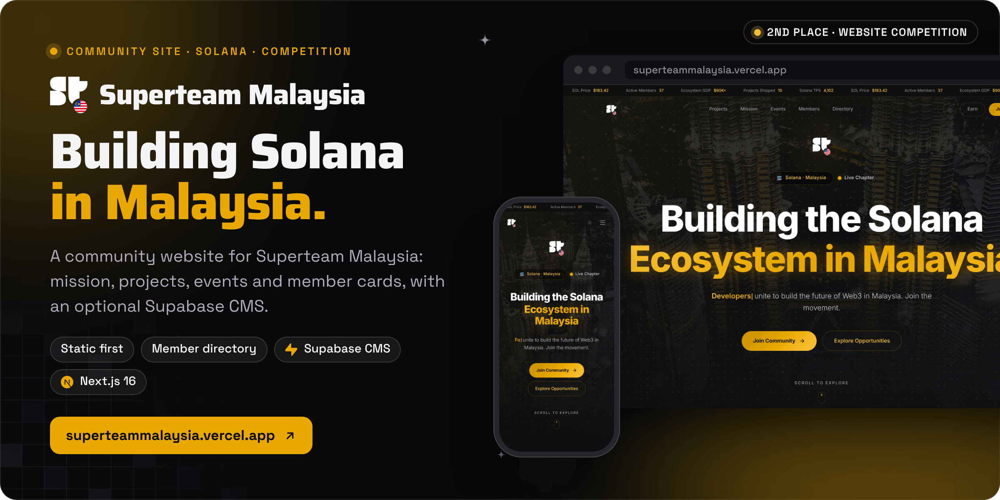

<div align="center">



<br><br>

<a href="https://superteammalaysia.vercel.app"></a>&nbsp;&nbsp;
<a href="https://superteammalaysia.vercel.app/members"></a>&nbsp;&nbsp;
<a href="#run-it-locally"></a>

<br><br>

<a href="https://superteammalaysia.vercel.app"></a>


<h3>Malaysia's Solana builders, projects and events, on one page.</h3>

<b>Discover</b> &nbsp;→&nbsp; <b>Browse</b> &nbsp;→&nbsp; <b>Attend</b> &nbsp;→&nbsp; <b>Meet</b> &nbsp;→&nbsp; <b>Join</b>

<br>

<a href="#how-it-works">How it works</a> &nbsp;·&nbsp;
<a href="#results">Results</a> &nbsp;·&nbsp;
<a href="#run-it-locally">Run it locally</a> &nbsp;·&nbsp;
<a href="#content-and-admin">Content and admin</a>

</div>

<br>

<picture>
  <source media="(prefers-color-scheme: dark)" srcset="docs/readme/screens-dark.png">
  
</picture>

<p align="center"><sub>Captured from a local production build (<code>pnpm build && pnpm start</code>) with the built-in static data on 30 October 2026. The ticker's SOL price is its fallback value, because CoinGecko is unreachable from this environment. Member and testimonial photos load from unavatar.io, also unreachable here, so those sections are not shown.</sub></p>

**This is a community website for Superteam Malaysia, built for the Superteam Malaysia Website Competition, where it placed 2nd.** It presents the chapter's mission, Solana projects built in Malaysia, events and members, plus a searchable member directory. All content ships as static data, so the site runs with no backend; once Supabase is configured, its rows replace the defaults section by section, and a prototype `/admin` dashboard edits them.

Built by Matt ([RVAClassic](https://x.com/rvaclassic), [Operator Uplift](https://operatoruplift.com)) in March 2026 for the competition.

<br>

## How it works

<picture>
  <source media="(prefers-color-scheme: dark)" srcset="docs/readme/flow-dark.png">
  
</picture>

<table>
  <tr valign="top">
    <td width="33%"><b>Static first</b><br><sub>Every section renders from <code>src/data/site.ts</code>: 16 events, 37 members, 10 projects, 10 partners, 6 testimonials and the FAQ. No database or API key is needed to build or run the site.</sub></td>
    <td width="33%"><b>Supabase when you want it</b><br><sub>The events, members, partners, projects and testimonials hooks read their table and keep the static list when the table is missing, empty or unreachable. A deploy without Supabase variables still builds and renders.</sub></td>
    <td width="33%"><b>Collectible member cards</b><br><sub>Members appear as trading-card profiles with rarity tiers, skill tags and a flip to reveal stats. <code>/members</code> adds search, skill, lane and rarity filters, and sorting by rarity, name or connections.</sub></td>
  </tr>
</table>

Also on the page: a ticker with a live SOL price from CoinGecko (the other ticker figures are fixed values), a canvas dot grid behind the hero and the join call to action, an auto-scrolling Wall of Love with a follow card for X, a partner logo marquee, an FAQ, a Kuala Lumpur skyline footer, generated Open Graph and X images, and dark and light themes that remember your choice.

<p align="center"><sub>Next.js 16.1 (App Router, Turbopack) · React 19 · TypeScript · Tailwind CSS 4 · Framer Motion · Supabase JS · lucide-react · ABC Diatype (self-hosted) · Vercel</sub></p>

<br>

## Results

<table>
  <tr valign="top">
    <td width="16%" align="center"></td>
    <td>2nd place in the Superteam Malaysia Website competition (Superteam, $3,000 pool). The pool is the event total, not a payout. The result is listed on the operatoruplift profile.</td>
    <td width="22%"><a href="https://github.com/operatoruplift">operatoruplift profile</a></td>
  </tr>
  <tr valign="top">
    <td align="center"></td>
    <td>Scaffolded on 11 March 2026 and built on 13 March 2026: the full site, then a day of fixes and features merged as eleven pull requests (Supabase CMS wiring, the world map, testimonials, mobile fixes). A twelfth pull request on 6 May 2026 addressed horizontal overflow on Android phones.</td>
    <td><a href="https://github.com/operatoruplift/superteam-malaysia-website/pulls?q=is%3Apr+is%3Amerged">Merged pull requests</a></td>
  </tr>
  <tr valign="top">
    <td align="center"></td>
    <td><a href="https://superteammalaysia.vercel.app">superteammalaysia.vercel.app</a> is Vercel's production deployment of <code>main</code> (commit <code>3e3d03d</code>, deployed 6 May 2026, ready when checked on 30 October 2026), with Supabase configured. The older <code>sun-valley-rouge.vercel.app</code> address redirects there.</td>
    <td><a href="https://superteammalaysia.vercel.app">Visit the site</a></td>
  </tr>
  <tr valign="top">
    <td align="center"></td>
    <td>The <code>/admin</code> CMS. It edits content directly through the public Supabase client, and its access control is a prototype; see <a href="#content-and-admin">Content and admin</a> before you rely on it.</td>
    <td><a href="supabase/schema.sql">Database schema</a></td>
  </tr>
</table>

<br>

## Run it locally

<table>
  <tr valign="top">
    <td width="33%"><b>Prerequisites</b><br><sub>Node 20.9 or newer (Next.js 16; Vercel builds on Node 24) and pnpm 10. A Supabase project only if you want the CMS.</sub></td>
    <td width="33%"><b>Read first</b><br><sub><a href="src/data/site.ts"><code>src/data/site.ts</code></a> holds all default content, and <a href="supabase/schema.sql"><code>supabase/schema.sql</code></a> creates the CMS tables.</sub></td>
    <td width="33%"><b>What the checks prove</b><br><sub>Types and a production build. ESLint currently reports 8 errors and 4 warnings (React effect and image rules). There are no automated tests.</sub></td>
  </tr>
</table>

### 1. Run the site

```bash
git clone https://github.com/operatoruplift/superteam-malaysia-website.git
cd superteam-malaysia-website
pnpm install
pnpm dev                     # http://localhost:3000, using the static data
```

### 2. Check it

```bash
pnpm exec tsc --noEmit       # TypeScript, strict mode
pnpm lint                    # ESLint (Next.js core web vitals and TypeScript rules)
pnpm build && pnpm start     # production build, served on http://localhost:3000
```

### 3. Connect Supabase (optional)

1. Create a [Supabase project](https://supabase.com/dashboard), open the SQL editor and run [`supabase/schema.sql`](supabase/schema.sql). It creates the `events`, `members`, `partners`, `projects`, `announcements`, `site_content` and `testimonials` tables, with indexes and auto-updated timestamps.
2. Copy the environment file and fill in your project's values:

```bash
cp .env.example .env.local
```

| Variable | Purpose |
|---|---|
| `NEXT_PUBLIC_SUPABASE_URL` | Your Supabase project URL. Without it, and the anon key, the site uses the static data |
| `NEXT_PUBLIC_SUPABASE_ANON_KEY` | Supabase anon key, used for the public reads and by `/admin` |
| `SUPABASE_SERVICE_ROLE_KEY` | Read only by `createAdminClient()` in `src/lib/supabase.ts`, which no page calls yet. Server-side only: never prefix it with `NEXT_PUBLIC_` |
| `NEXT_PUBLIC_SITE_URL` | Base URL for metadata and social images; defaults to `https://sun-valley-rouge.vercel.app` |

On Vercel, add the same variables under **Settings → Environment Variables** and redeploy, or deploy from the CLI with `vercel deploy --prod`.

<br>

## Content and admin

Visiting `/admin` opens a dashboard with tabs for events, members, partners, projects, testimonials, announcements and site content. Events, members, partners, projects and testimonials appear on the public site; announcements and site content are editable but no public page reads them yet.

The dashboard writes with the anon key from the browser, so `supabase/schema.sql` pairs public-read policies with open write policies on every content table. That is fine for a demo project but means anyone holding the anon key can edit content. Before you put real content behind it, replace the write policies with ones limited to an authenticated admin role (or move writes to a server route that uses the service-role key), and put real authentication in front of `/admin`.

<details>
<summary><b>Project structure</b></summary>
<br>

| Path | Contents |
|---|---|
| `src/app/page.tsx` | The landing page: hero, mission, stats, projects, events, members, global network, Wall of Love, FAQ, partners and the join call to action |
| `src/app/members/` | The member directory with search, filters and sorting |
| `src/app/admin/` | The prototype CMS dashboard |
| `src/app/opengraph-image.tsx`, `twitter-image.tsx` | Generated social images (edge runtime) |
| `src/components/` | Section components, the dot grid canvas, the stat ticker, the theme provider and the KL skyline art |
| `src/data/site.ts` | All default content and the member rarity rules |
| `src/hooks/useSupabaseData.ts` | Supabase reads with the static fallback |
| `src/lib/` | The Supabase clients and generated database types |
| `supabase/schema.sql` | Tables, indexes, triggers and RLS policies |
| `scripts/gen-world-map.mjs` | Generates the dot coordinates for the world map |
| `public/` | Event covers (AVIF), partner and project logos, Superteam Malaysia logos, the Petronas hero photo and the fonts |

</details>

<details>
<summary><b>Design decisions</b></summary>
<br>

- **Gold on dark** follows the Superteam brand while adding warmth for the Malaysian chapter.
- **Petronas Towers imagery** with an animated dot grid gives a recognizable Malaysian identity.
- **Collectible member cards** with rarity tiers add a little gamification to the member list.
- **Static first, CMS second**: the site ships as prerendered pages with static data, and Supabase enhances it when present.
- **Tailwind CSS 4** with CSS variables keeps the dark and light themes consistent.

</details>

<br>

<p align="center"><sub>Built for the Superteam Malaysia Website Competition. This repository has no license file. Superteam, partner and project names and logos belong to their owners.</sub></p>

<p align="center"><sub>Built by <a href="https://rvaclassic.xyz">Matt Sim</a>, founder of <a href="https://operatoruplift.com">Operator Uplift</a>. More builds at <a href="https://github.com/operatoruplift">github.com/operatoruplift</a>. Want one built for your product? <a href="https://cal.com/rvaclassic/15min">Book a 15-minute call</a>.</sub></p>
